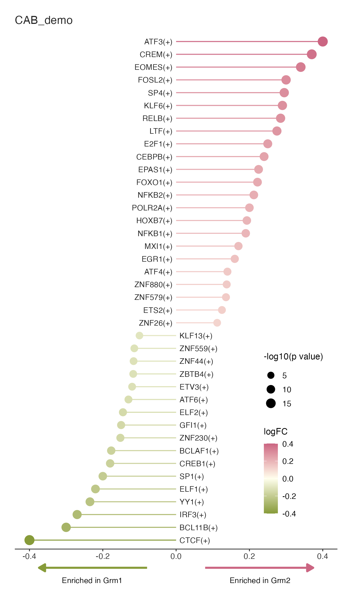
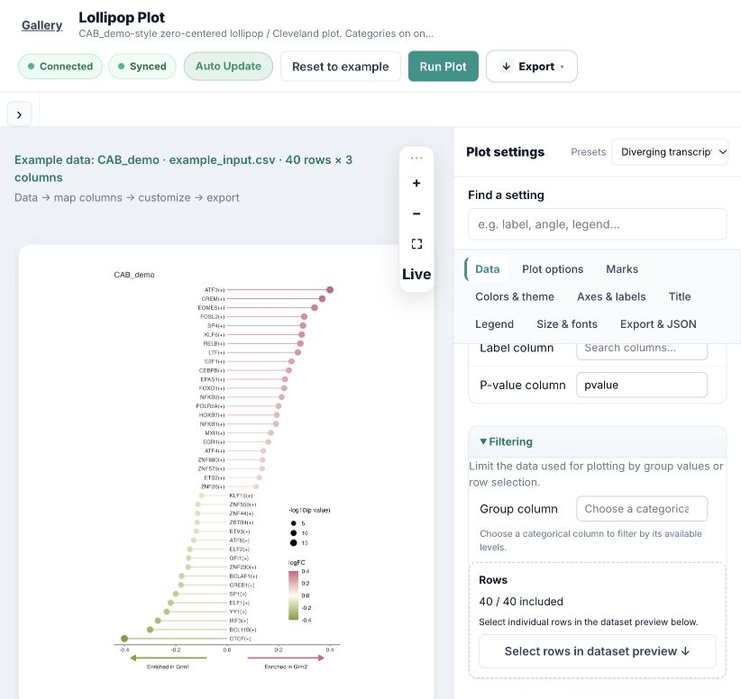

# Diverging TF lollipop — 2026-10-25

Extended `interactive_enrichment_lollipop` to version 1.2.0 instead of creating
a duplicate plugin: the data roles and zero-centered stem/point grammar match
the existing engine. The supplied screenshot is the visual reference. `CAB_demo`
contains synthetic illustrative effects/probabilities, not the paper's data.

## Implemented

- Continuous signed-effect coloring on stems and heads, centered at zero, with
  configurable negative/neutral/positive colors.
- `size_transform: neg_log10_pvalue`: transforms the mapped probability once.
  Rejects missing, nonfinite or out-of-range probabilities. Numerical zeros are
  floored and logged; raw probability and transformed size are exported.
- Category names on the empty side of the zero axis, opposite each stem. Gap,
  font size, face and color can be customized. Horizontal layout has enrichment
  arrows and editable group labels below the tick labels.
- Inside/outside legends; value sorting; existing filtering, head shape/size,
  titles, dimensions and PNG/SVG/PDF exports remain available.
- A searchable **Diverging TF Lollipop** variant in the existing Lollipop chart
  family, also discoverable in single-cell and differential-analysis contexts.
  Studio category and vNext scientific family remain Set / Enrichment and
  enrichment, respectively. Registry/metadata were regenerated by their CLIs.
- Removed stale output files on failure. PNG now uses ragg; effect-axis expansion
  leaves room for boundary markers. All five resulting example images and one
  PDF were reviewed before updating baselines. Baselines changed intentionally
  for deterministic PNG output/endpoint padding, plus the new reference example.
- Fixed editor legend-title aliasing: the control now reads/writes the actual
  `legend_title` declared by the plugin. A preset's title no longer shadows edits
  to an unrelated alias. Added a frontend regression test.
- Fixed a registry publication race exposed during concurrent build/tests:
  registry writes now use the existing atomic writer. Added a test proving that
  the old valid JSON remains readable until publication.

The installed Plotly converter cannot convert the reference layout (`subscript
out of bounds`). Optional HTML conversion now preserves all static exports and
returns a labelled, self-contained static image on conversion failure; the log
and `figure.json.interactive_html` record the fallback. This was exercised with
the reference example's interactive flag enabled. No interactive success is
claimed for that layout. Printed PNG/SVG/PDF match the reviewed layout.

## Gates

| Gate | Actual result |
|---|---|
| Plugin standards | 1 plugin; 0 new violations, 0 baselined |
| Parameter sensitivity | 65 parameters; 0 crashes; 19 mode/data-dependent no-effects, explained below and in schema help |
| Plugin smoke compare, twice | 5/5 passed both times; 0.000% pixel changes in all five examples |
| Registry validation | 57 plots; valid; 0 errors; 33 existing warnings |
| vNext migrate, this plugin | 1 migrated/curated; no warnings; registry valid |
| `pytest -q plot_web/tests vnext/tests` | 106 passed; one existing Starlette/httpx deprecation warning |
| Full smoke compare | **79/236 passed: DIFF=133, FAIL=24, ok=79** |

The full suite is **not green**. Before this task it was 74/235 with 137 DIFF and
24 FAIL. Four existing Lollipop differences now match reviewed baselines, and
the new example passes; unrelated dependency/render failures remain. No unrelated
baselines were updated.

The 19 no-effects in the sorted, single-group reference example:

- `sort_by`: input order already equals decreasing-value order.
- `stem_color`: categorical-color mode only.
- `r`: fixed-size mode only; `min_radius`/`max_radius`: overridden by the example's
  explicit `point_size_min`/`point_size_max`.
- `point_border_color`: filled shapes 21–25 with nonzero stroke only.
- `padding`/`dodge`: multiple groups required.
- `zero_line_color`/`zero_line_width`/`zero_line_linetype`: zero line is hidden.
- `label_nudge_x`/`label_repel`: numeric head labels are disabled; central category
  names use their separate position/gap.
- `x_title_show`/`y_title_show`: example axis titles are empty.
- `x_min`/`x_max`: explicit `x_limits` take precedence.
- `grid_major_color`: grid is hidden.
- `y_axis_text_size`: category-axis labels are hidden in zero-opposite mode.

Five new R integration cases verify probability transformation, signed sorting,
zero-probability handling, filled heads/optional HTML without loss of static
exports, and rejection of negative, greater-than-one or missing probabilities.
Browser checks confirmed gallery discovery, the correct preset/data preview,
and an edited legend title appearing in a fresh rendered figure. Raw p-value
scientific warnings remain visible; no multiple-testing adjustment is fabricated.

