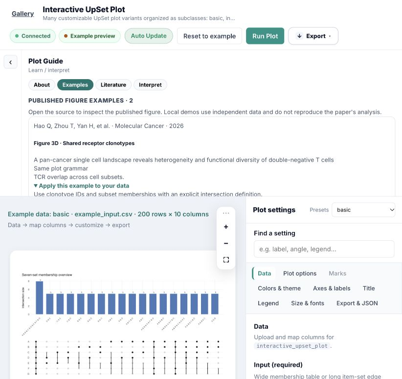

Latest extension results: [source collection and 22 specialty engines](figureya_implementation_qa_2026-10-25.md). The earlier counts below are a historical snapshot.

# Plot Guide validation — 2026-10-25

This records the English/literature update before the subsequent circular tree +
embedding addition. Current inventory counts include that later plot; its checks
are tracked in [the composite-plot validation](circular_tree_embedding_2026-10-25.md).

## Scope and coverage

All 57 Guide sources and the coverage report use English. All 43 visible plots have
Guides; 14 hidden legacy entries retain documentation without changing visibility.
The [coverage report](plot_guide_coverage_2026-10-25.md) lists every plot, application
scenario, input requirement, customization control, local demo and literature gap.

The curated library contains 38 references and 76 unique checked figure records.
All 43 visible plots have a figure association; 35 have at least one same-grammar
example and eight have related layouts only. Twenty-eight visible plots have figure
examples from at least two distinct references. The target of 2–3 suitable references
per plot is not universally met; remaining gaps are explicitly listed.
There are 145 independent local demo bundles: 48 entries have 2–3, nine have one.

Published examples include figure/panel labels, citations, DOI, source links,
application descriptions and adaptation notes. Primary publisher captions, article
text or author-hosted primary PDFs were checked before adding panel labels.
Links open a verified figure page where available, otherwise the captioned article
or PDF. Related layouts and preprints are identified. Same grammar does not imply
an exact reproduction. Original images are not copied, and local demo data are
not presented as the cited paper's data.

## Validation results

| Check | Result |
|---|---|
| Guide inventory and local/figure reference validation | 57 Guides; zero validation errors |
| Visible Guide API and local example loading | All 43 visible entries covered by tests |
| Plugin standards | 57 plugins; zero new violations; 1571 baselined |
| Registry build / validate | 57 plots; valid; zero errors; 33 existing warnings |
| Web / vNext tests | 120 passed; one existing Starlette/httpx deprecation warning |
| Full image regression | 79/236 passed; 133 DIFF; 24 FAIL |
| Rendering, parameters, input data and image baselines | Unchanged in this English/literature update |

The full image gate remains unsuccessful, with the same 79 / 133 / 24 distribution
as the preceding run. Guide coverage does not establish that every R engine can
regenerate its previews. No image baselines were updated. The failed examples are:

| Engine | Failed examples |
|---|---|
| alluvial_plot | basic, edges, hx_lineage, long |
| interactive_binary_plot | basic, custom_layout, interactive |
| interactive_bubble_score_matrix | basic, custom, interactive, multi_score |
| interactive_correlation_matrix | basic, interactive, lower_triangle |
| interactive_motif_logo_plot | basic, custom, interactive |
| interactive_sankey_plot | basic, custom_layout, interactive |
| sca_volcano_plot | percent |
| stat_plot | sankey, upset, venn |

Parameter sensitivity was not rerun for this documentation-only update: no plotting
parameter, renderer or example bundle changed. The preceding lollipop validation
reported 65 parameters, zero crashes and 19 mode-dependent no-effect results; see
[that validation](diverging_tf_lollipop_2026-10-25.md). Classification and vNext
metadata were unchanged.

## Interface review

Verified the English UpSet Examples tab in the running local server, with published
Figure 3D and Figure 4A listed before local demos. Expanded the adaptation disclosure
and checked citation/source links. Tests additionally cover family-specific panel
filtering, related-layout and preprint labels, HTML escaping, English text and local
Try Example controls. Existing preview images were not altered in this update.



## Reproduction

```bash
plot_web/.venv/bin/python scripts/report_plot_guides.py
plot_web/.venv/bin/python -m plot_web.plot_registry build
plot_web/.venv/bin/python -m plot_web.plot_registry validate
plot_web/.venv/bin/python -m pytest -q plot_web/tests vnext/tests
plot_web/.venv/bin/python scripts/check_plugin_standards.py
plot_web/.venv/bin/python scripts/smoke_plugins.py --compare --jobs 6
```

The [registry authoring contract](../../plot_web/registry/README.md) documents panel
provenance, matching and publication-status fields. Regenerate coverage statistics
from source YAML and manifests rather than editing the generated report manually.
