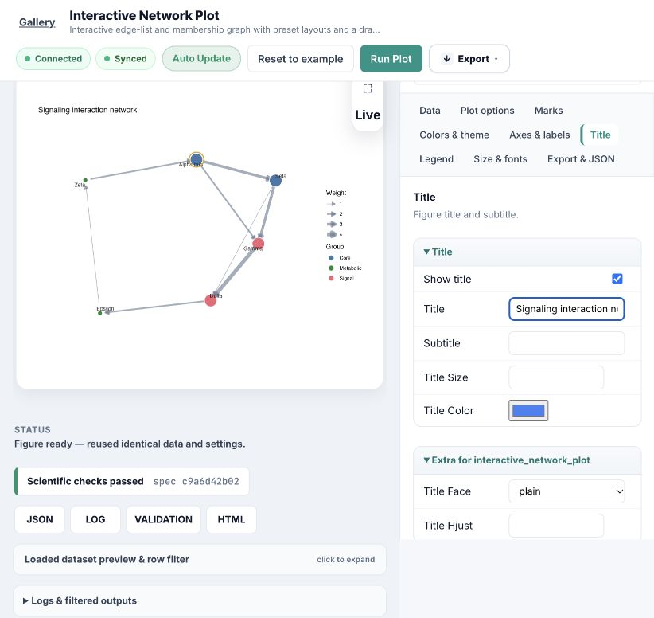

# Shared render responsiveness — 2026-10-24

Implemented the follow-up to `plot_performance_2026-10-24.md` in the shared web
runner/editor. No R drawing code, plugin parameter defaults or image baselines
were changed by this optimization.

## Behavior

- Bundled examples open from their existing PNGs, labelled **Example preview**.
  Opening, resetting or switching a bundled preset does not launch R. Examples
  without an image retain the render fallback. Explicitly uploaded data is never
  replaced by an example preview when choosing a preset.
- **Export → Generate export files** renders the current example when needed.
  Downloads remain disabled for unrendered settings. Old scientific-validation
  results are cleared when displaying a different built-in example.
- R results use a checksum-verified, content-addressed cache with 128 entries by
  default. Inputs, parameters (including referenced auxiliary files), seed,
  plugin/shared R/server/PlotSpec code, R binary/version, package DESCRIPTIONs,
  profiles and relevant environment settings contribute to the key. Scientific
  validation and job-specific PlotSpec/URLs are regenerated on a hit. Original
  artifact metadata is retained, with the source job recorded in `cache`.
- Identical concurrent requests share a render lock. Background workers default
  to two concurrent subprocesses. New settings replace older queued work from
  the same editor; running R processes remain isolated.
- Background job polling exposes a preview once a complete PNG or SVG exists;
  it never advertises an unfinished PNG/SVG. Export links wait for job completion.
  Revision guards reject old results, including during Plotly's lazy loading.
- Static pages no longer synchronously download Plotly from the external CDN.
  The library loads only for an actual Plotly JSON preview.

The preview mechanism observes completed files during the normal full render.
It does not change device order or introduce a reduced-quality preview render.
Persistent R workers and cross-device reuse of prepared plot objects are not
implemented. New/custom uncached figures still incur their usual R startup and
drawing costs. The first cached-capable job also fingerprints the R environment;
the entire fingerprint stage took 4.12 seconds in the first UI run on this machine.

## Measurements

Actual HTTP requests to the restarted local service on port 8010. Four plugins,
two requests each with identical example inputs/parameters. Poll interval 100 ms.
An independent full image regression was running concurrently, so these are
loaded-machine observations, not an idle/cold-start benchmark. The first row for
each plugin is a confirmed application-cache miss; the second is a confirmed hit.

| Plugin | Uncached completion | First preview | Cached completion |
|---|---:|---:|---:|
| ternary_plot | 8.450 s | 6.531 s | 0.820 s |
| sca_volcano_plot | 14.026 s | 9.661 s | 0.223 s |
| group_heatmap | 15.641 s | 14.875 s | 0.231 s |
| interactive_network_plot | 4.625 s | 3.506 s | 0.232 s |

All eight jobs completed. Background acceptance took 6–58 ms. Browser polling is
250 ms, so browser-observed cache completion can include another polling interval.
All 16 cached PNG/SVG/PDF/figure.json artifacts were byte-identical to the source
render. A contact-sheet review covered those four example figures; existing
dense Volcano labels and heatmap feature-label spacing are not solved by caching.

Browser checks: Network and Group Heatmap open as labelled example previews;
Network exports complete and a repeated Run Plot reports reuse of identical data
and settings. Changing its title triggers a fresh render and visibly updates the
figure. The export menu offers generation before downloads are available.

## Validation

- `pytest -q plot_web/tests vnext/tests`: 100 passed; one existing Starlette/httpx
  deprecation warning. Latest frontend-only checks also pass (21 tests).
- Added coverage for dependency invalidation, corrupted cache recovery, validation
  before lookup, concurrent deduplication, bounded/disabled cache, package changes,
  partial-image safety, background snapshots, queued-work replacement, opt-in API
  compatibility, demo preview without rendering, export state and stale responses.
- `check_plugin_standards.py group_heatmap`: 0 new violations, 92 baselined.
- `param_sensitivity.py group_heatmap`: 8 parameters, 0 crashes, 1 no effect
  (`show_column_names`, existing cell-mode behavior in shared R).
- Registry validation: 57 plots, valid, 0 errors, 33 warnings.
- Full smoke comparison: **74/235 passed (DIFF=137, FAIL=24, ok=74)**, identical
  counts to the pre-optimization checkout. These gates remain failing; baselines
  are preserved. Failures include missing ggsankey, universalmotif, see, ggupset,
  missing Pandoc in affected plugins and the existing stat_venn S4 error. The
  optimization does not resolve those dependency/rendering issues.

Configuration and asynchronous API details are in `plot_web/README.md` under
Render responsiveness. Defaults preserve synchronous API callers; only the
editor opts into background polling.
