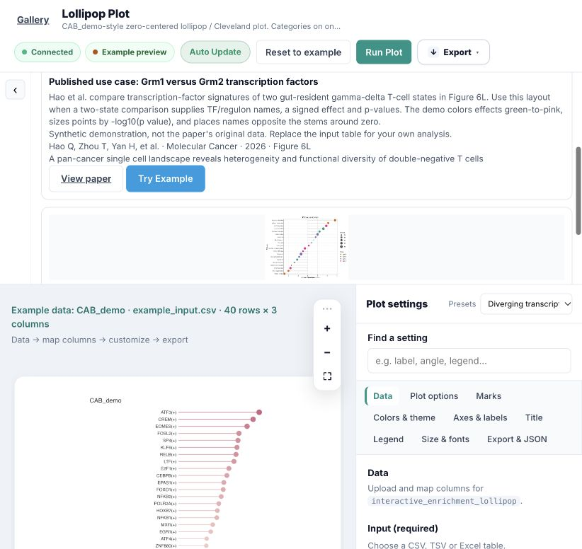

# TF lollipop: published case and workflow skill — 2026-10-25

## Published source and guide

Verified the publisher's article and Figure 6 caption:
[Hao et al., Molecular Cancer 25:24 (2026)](https://link.springer.com/article/10.1186/s12943-025-02548-8),
DOI `10.1186/s12943-025-02548-8`. Figure **6L** is the supplied lollipop use case,
comparing Grm1/Grm2 transcription-factor signatures within gut-resident
T11_ITGA1+ gamma-delta T cells. The publication date is 2026, despite 2025 in
the DOI suffix.

Added `plot_web/registry/guides/enrichment_lollipop.yaml` and the curated
`hao_dnt_2026` literature entry. Examples explains when to use the plot, the
necessary comparison-table columns and the reference encoding. Its card links
the paper and the runnable `CAB_demo` preset. Literature gives the full citation,
Figure 6L, article URL and source terms. Interpret describes current supplied
effect/probability mappings and does not claim group colors when effect coloring
is selected. No publisher figure was copied; the preview is the existing synthetic
demo, explicitly distinguished from the paper's data.

## Skill and actual application integration

- Added `skills/diverging-tf-lollipop/SKILL.md` with frontmatter, a scoped workflow
  role, the existing engine/variant/preset, column mapping, contrast/sign handling,
  raw versus adjusted probabilities, invocation commands and publication context.
- Updated the plugin's existing `SKILL.md` and the main plot-authoring skill to
  route to it. The Claude entry is already a symlink to the authoring skill, so
  the same routing is available there. Removed angle brackets from the existing
  authoring skill's frontmatter description to satisfy its validator.
- AI Studio matches English/Chinese TF/regulon lollipop requests to the plugin,
  reference variant/editor URL and the project workflow skill. Generic requests
  saying only "plot" do not select this scoped skill.
- The uploaded-table adapter preserves explicitly identifiable name/effect
  columns, prefers an existing adjusted-probability column, and labels that
  source. It does not invent probabilities or effects; missing probabilities
  use fixed-size points. Missing effect/name mappings raise an actionable error
  in the adapter (the existing AI demo route reports its built-in-demo fallback).
- Skills are workflow instructions; the plugin remains the renderer. The returned
  skill role/note now distinguishes workflows from plugin-authoring guides.

This is project-local skill integration, not a global personal-skill installation.

## Verification

| Check | Actual output |
|---|---|
| Skill validator, new workflow | Skill is valid |
| Skill validator, authoring entry | Skill is valid |
| Plugin standards | 0 new violations, 0 baselined |
| Parameter sensitivity | 65 parameters; 0 crashes; 19 existing mode/data-dependent no-effects |
| Registry build/validate | 57 plots; valid; 0 errors; 33 existing warnings |
| Python web/vNext tests | **114 passed**, one existing Starlette/httpx warning |
| Plugin image comparison in full run | All **5/5**, each 0.000% pixel changes |
| Full image comparison | **79/236 passed; DIFF=133, FAIL=24, ok=79**, unchanged from before this follow-up |

The repository-wide image gate remains failing for existing unrelated differences
and render/dependency problems. No R renderer, input bundle, plot parameter or
image baseline was changed in this follow-up. The 19 sensitivity no-effects are
documented in the preceding diverging-lollipop QA report and schema help.

New checks cover the publication/example/preset cross-reference, synthetic-data
notice, actual current mappings, safe example-card rendering, scoped skill
matching, AI recommendation API output and probability-column selection. Browser
review verified Examples and Literature, the correct article link, and Try Example
loading the 40-row reference preset without rerunning R. The local service was
restarted for the application changes.

